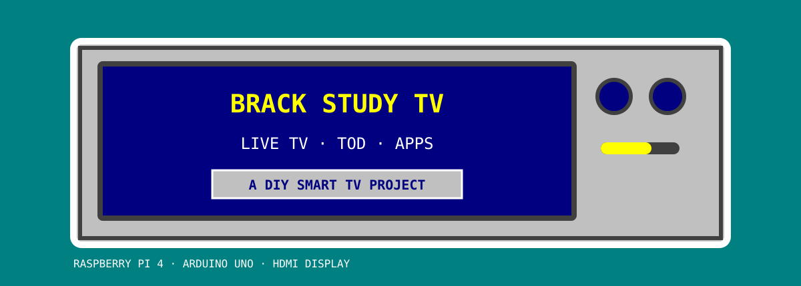

  

  <strong>A DIY television interface built around a Raspberry Pi, Arduino controls and a reused HDMI display.</strong>

  
  
  

# Retro TV

Retro TV turns a Raspberry Pi and HDMI monitor into a vintage-style TV interface. It uses a Python/GTK app, mpv playback, web-app tiles, Arduino Uno joystick and volume controls, and a separate Raspberry Pi GPIO3 shutdown button.

## On this page

[What it does](#what-it-does) · [Controls and hardware](#controls-and-hardware) · [Project files](#project-files) · [Getting started](#getting-started) · [Project status](#project-status) · [Notes](#notes)

## What it does

- Plays IPTV through **mpv** in a TV-style interface.
- Uses an **Arduino Uno** for joystick navigation and volume-knob input.
- Includes web-app tiles and a channel list.
- Uses a separate **GPIO3** button for safe Pi shutdown.
- Reuses a **22-inch HDMI monitor** in the current build.

## Controls and hardware

| Part | Role |
|---|---|
| Raspberry Pi 4 | Runs the TV app and IPTV playback |
| HDMI monitor | Reused display for the project |
| Arduino Uno + joystick | Navigates the TV interface |
| Volume encoder | Sends volume-up and volume-down input |
| Shutdown button | Connects to Pi GPIO3 (physical pin 5) and GND |

> **Button wiring:** Connect the shutdown button only to the Pi’s GPIO3 and GND. It does not connect to Arduino D4.

## Project files

| Folder | What you’ll find |
|---|---|
| [raspberry_pi/](raspberry_pi/) | TV app, playlists, sounds, installers, bridge, services, power-button script, Windows launcher and Pi diagnostics |
| [arduino/](arduino/) | Current Uno firmware and separate diagnostic or older sketches |
| [enclosure_work/](enclosure_work/) | Enclosure models and design review |
| [docs/](docs/) | Software notes and historical build guide |
| [pptx_work/](pptx_work/) | Current project-fair PowerPoint and presentation source materials |
| [tests/](tests/) | Offline app checks |
| [downloads_archive/](downloads_archive/) | Historical snapshots; not installation sources |

## Getting started

Start with the [Raspberry Pi setup guide](raspberry_pi/README.md) to transfer and install the Pi software.

Flash [rpi_controller_final.ino](arduino/rpi_controller_final/rpi_controller_final.ino) to the Uno using Arduino IDE.

The old root files and duplicate `pi_kit/` have been consolidated. Existing installed paths (`~/tv.py`, `/opt/rpi-bridge/`, and systemd units) are unchanged. The Arduino firmware has one current source; all copies were identical before consolidation.

Future app changes must also update the embedded source in `raspberry_pi/install_tv.sh`.

## Project status

The frame is reported complete. The current build uses a 22-inch HDMI monitor; other sizes may need different enclosure measurements. See the [22-inch design review](enclosure_work/DESIGN_REVIEW_22IN.md). CAD monitor dimensions are still placeholders, not final cutting measurements.

The current 12-slide project-fair deck is the owner-supplied replacement documented in `pptx_work/README.md`. Playback still needs testing on the replacement Pi.

## Notes

- [Speaker volume and automatic icons](docs/TV_VOLUME_AND_ICONS.md)
- [Windows instructions](raspberry_pi/README_WINDOWS.txt)
- [Project-fair deck](pptx_work/Retro-TV-Project-Fair-Deck.pptx)
- [Project log](PROJECT_LOG.md) — older paths describe the layout at that time.
- [Historical build guide](docs/HISTORICAL_BUILD_GUIDE.md) — obsolete Kodi, wiring and 14-inch instructions.

INTERFACE COLORS: <code>#008080</code> TEAL · <code>#C0C0C0</code> SILVER · <code>#000080</code> NAVY · <code>#FFFF00</code> YELLOW

